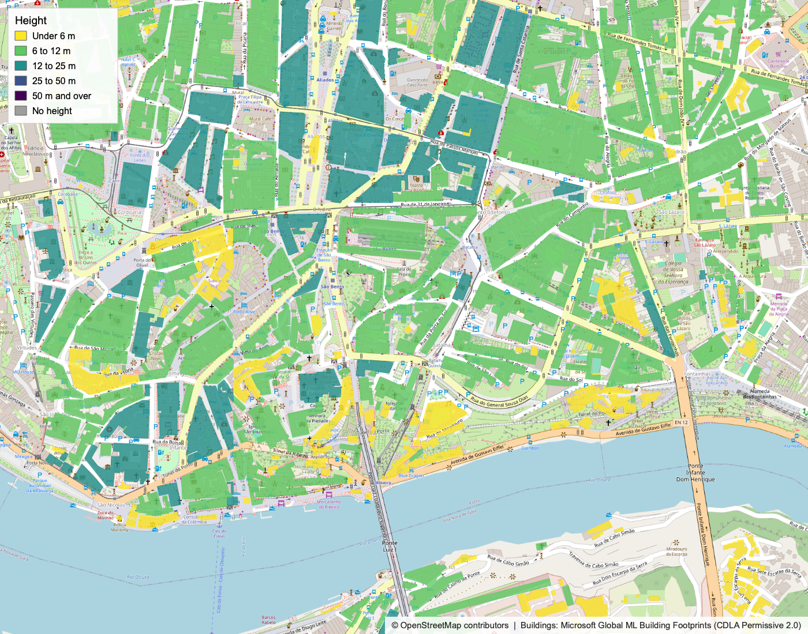

# GlobalML Buildings Downloader (QGIS plugin)

> **Unofficial.** This plugin is not made, endorsed or supported by Microsoft. It reads the files Microsoft publishes. Report problems with the plugin [here](https://github.com/ColdLabs/qgis-globalml-buildings/issues), not to Microsoft.

Downloads [Microsoft Global ML Building Footprints](https://github.com/microsoft/GlobalMLBuildingFootprints) for the map view or the polygons of a layer, as polygons, centroid points or both. Attributes: `height` (metres), `confidence`, `area_in_meters`, `region`, `quadkey`. Output CRS is EPSG:4326.

Coverage is 225 regions worldwide, with gaps. It includes Europe, North America and Australia, which [Google Open Buildings](https://github.com/ColdLabs/qgis-open-buildings) does not cover.

`height` is set where Microsoft estimated it and empty elsewhere. For example, it is set for every building in central Porto and for none in the Portuguese side of the Minho valley. `confidence` was empty in every file we sampled. Microsoft writes -1 for an unknown value, and the plugin writes it as NULL.



*Central Porto, Portugal: 504 buildings from the plugin, as QGIS loads them, coloured by height.*

Layers loaded into QGIS are coloured by `height` (lower bound inclusive): under 6 m, 6 to 12 m, 12 to 25 m, 25 to 50 m, and 50 m and over, light to dark. That is roughly 1 to 2 floors, 3 to 4, 5 to 8, 9 to 16, and towers. Buildings with no height are grey, so they do not read as low buildings. Files written by `qgis_process` carry no style.

## Install

In QGIS: **Plugins → Manage and Install Plugins → All**, search for "GlobalML Buildings Downloader", then **Install**. Requires QGIS 3.38 or later (Qt5 or Qt6). No extra Python packages are needed.

To install without the plugin repository, download the zip from the [latest release](https://github.com/ColdLabs/qgis-globalml-buildings/releases/latest) and use **Plugins → Manage and Install Plugins → Install from ZIP**.

## Use

- Toolbar button (Web toolbar) or **Web → GlobalML Buildings**: opens the dialog with the current map extent filled in. If the active layer is a polygon layer with selected features, those become the area.
- **Processing Toolbox → Microsoft Global ML Buildings → Download buildings**: same algorithm; works in models and batch mode.
- Command line:

```
qgis_process run globalmlbuildings:download -- EXTENT="-8.615,-8.600,41.140,41.150 [EPSG:4326]" GEOMETRY=2 OUTPUT_POLYGONS=poly.gpkg OUTPUT_POINTS=pts.gpkg
```

`GEOMETRY`: 0 polygons, 1 points, 2 both. A building is kept when its centroid falls inside the area. Points are the polygon centroids, computed by the plugin.

## How it fetches data

Microsoft publishes one gzipped file of line-delimited GeoJSON per region and Bing zoom-9 tile (a quadkey such as `031332213`, about 78 km across at the equator and narrower toward the poles). The list of files is an index, `dataset-links.csv`, of about 6 MB. The plugin downloads the index once, works out which tiles touch the area (`quadkey.py`), downloads every file of those tiles and filters them locally. The largest file is about 300 MB.

A tile on a border has one file per region. Tile `031332213`, on the Minho river, has a Portugal, a Spain and a Europe file; the plugin fetches all three and keeps every building, with its region in `region`. Microsoft puts each building in the file of the tile that holds it. Rarely, a building on a tile edge sits in the file of the tile next door; when the area does not reach into that tile, the plugin does not download it and misses the building.

Microsoft has no stable "latest" link, so the plugin pins the 2026-08-13 release. To use another release, set **Index of tiles** (advanced parameter `INDEX_URL`) to its `dataset-links.csv` URL. The release name is the folder above `dataset-links.csv`.

Files are cached in `<QGIS profile>/cache/globalml_buildings/<release>/` and reused. Delete that folder to free space. The run stops before downloading if new downloads exceed the "Stop if new downloads exceed (MB)" value (2000 MB by default); sizes come from the index, and the index itself is not counted.

The plugin downloads through the QGIS network manager, so the proxy and SSL settings in QGIS apply.

## Data licence

Microsoft Global ML Building Footprints is published by Microsoft under the [Community Data License Agreement Permissive 2.0](https://cdla.dev/permissive-2-0/) (CDLA Permissive 2.0). Credit "Microsoft Global ML Building Footprints" and the release date (2026-08-13 by default) when you publish maps or data made with it. See the [dataset page](https://github.com/microsoft/GlobalMLBuildingFootprints). This plugin is not affiliated with Microsoft.

## Development

Link the plugin folder into your QGIS profile instead of installing the zip (macOS, QGIS 4):

```
ln -s "$PWD/globalml_buildings_downloader" ~/Library/Application\ Support/QGIS/QGIS4/profiles/default/python/plugins/
```

`uvx pytest` runs the tests of the parts that need no QGIS (`quadkey.py`, `index.py`). Set `GLOBALML_INDEX` to a downloaded `dataset-links.csv` to also parse the real index.
`./build_zip.sh` writes `dist/globalml_buildings_downloader-<version>.zip` for upload to plugins.qgis.org.
`./check.sh` runs the scanners the plugin site runs: Bandit and detect-secrets block an upload, flake8 is advisory.

## Licence

GPL-2.0-or-later. See [LICENSE](LICENSE).
